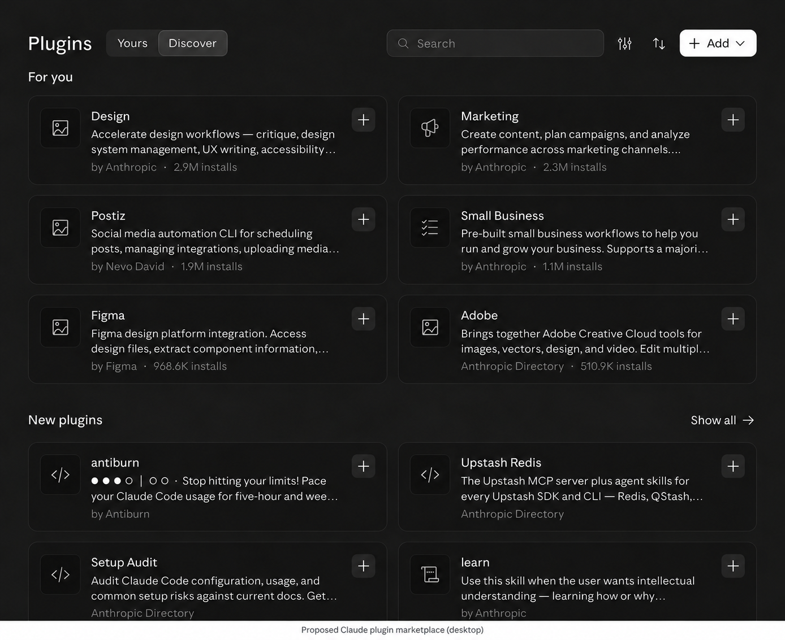
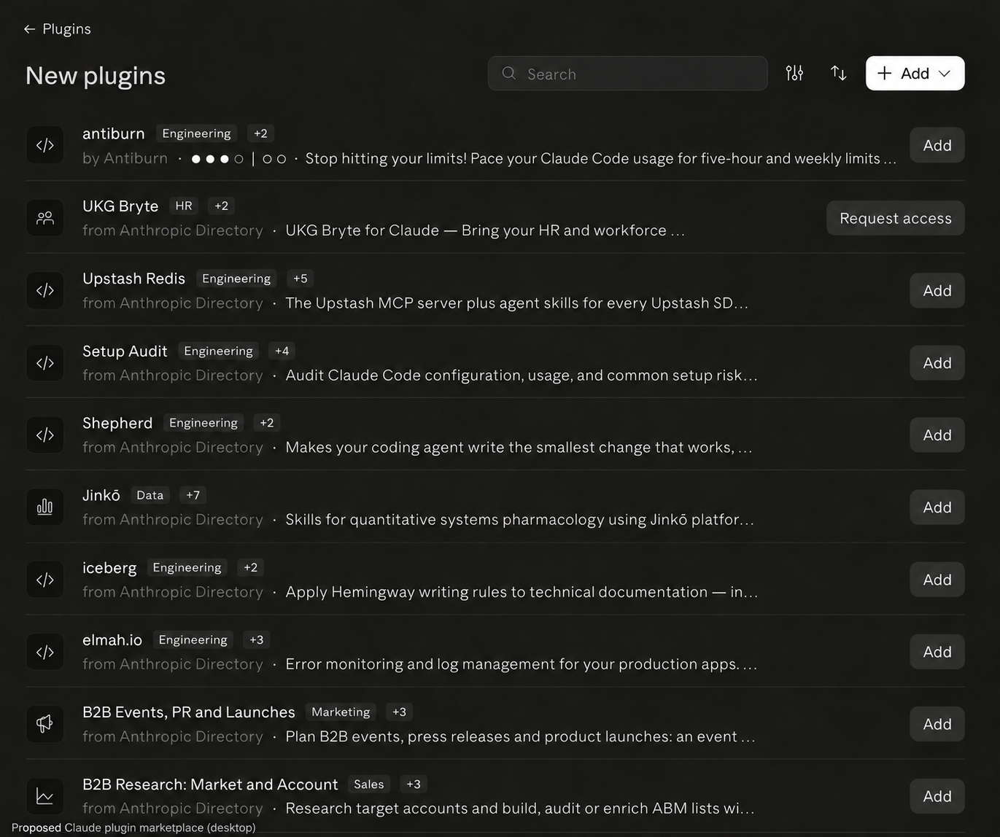
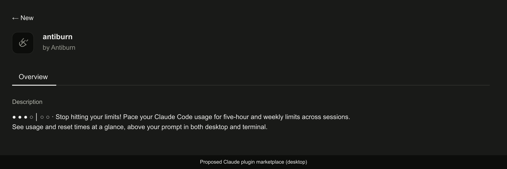

# Claude plugin marketplace submission handoff

## Candidate and owner

The **0.2.2** package updates listing metadata and documentation; all 20 other
public files are byte-identical to the immutable **0.2.1** artifact. The embedded
shared core remains 0.2.1. The package has 24 files. This work does not create a
GitHub Release, tag, directory submission or published listing.

The owner will perform all Claude portal work and submit manually. Repository
preparation, local checks, hosted delivery, main promotion and directory review
are separate stages. Do not treat a passing local validator as portal approval.

| Field                                              | Value                                                              |
| -------------------------------------------------- | ------------------------------------------------------------------ |
| Legal owner                                        | Cadence AI (Vic) Pty Ltd                                           |
| Public publisher / author                          | Antiburn                                                           |
| Plugin identifier                                  | `antiburn`                                                         |
| Version                                            | `0.2.2`                                                            |
| Repository                                         | `antiburn/antiburn`                                                |
| Plugin folder                                      | `plugins/antiburn`                                                 |
| Tracked branch                                     | `main`, after approved promotion                                   |
| Homepage                                           | https://antiburn.com/plugin                                        |
| Preferred categories                               | Engineering; AI models & agents; Productivity, in that order       |
| Repository catalog category                        | `developer-tools`; separate from directory categories              |
| Update detection                                   | Scheduled checks only                                              |
| Automatic publication                              | **Off**                                                            |
| Organization, eligible submitter and contact email | Owner to verify in the portal                                      |
| Existing draft or submission                       | Owner to check before creating a duplicate                         |
| GitHub connection                                  | Owner to verify write access in the submitting Claude organization |

Use the portal's available category labels. Developer tools is an acceptable
web-taxonomy equivalent of Engineering. Prefer `by Antiburn` attribution; some
host surfaces instead show their marketplace source, such as Anthropic
Directory. That source label does not identify the author.

## Canonical description

Copy this paragraph exactly into the authoritative release manifest and
repository catalog entry. The catalog can override the manifest.

> ● ● ● ○ │ ○ ○ · Stop hitting your limits! Pace your Claude Code usage for five-hour and weekly limits across sessions. See usage and reset times at a glance, above your prompt in both desktop and terminal.

The bar contains three filled circles, one hollow circle, U+2009 thin spaces on
both sides of U+2502, then two hollow circles. A normal space, U+00B7 middle dot
and normal space separate it from the slogan. The description is 205 Unicode
characters, with no leading space or manual line breaks. No separate excerpt
field is introduced. Keep the approved brand-first placement even when narrow
lists truncate before the full product explanation.

## Source and version identity

- Preparation baseline: `9b4d8ab7605f9208d06389579acde1abefe567dd`.
- Historical 0.2.1 artifact: `24c6c009be9787ed4a62db035eda992e49aa31e3`.
- Authoritative inputs: `plugins/antiburn-live/release`.
- Generated package: `plugins/antiburn`.
- Current candidate artifact commit: the full SHA in
  [the catalog](../../.claude-plugin/marketplace.json).
- The artifact commit contains the package; a later commit pins the catalog to
  it and updates the packaging test expectation. Preserve that artifact commit
  through merge. Do not squash or rebase it after its pin is recorded.
- Before manual submission, record the merged main SHA and compare its complete
  plugin tree with the pinned artifact, including docs, icon and licenses.

Only the manifest, README, changelog and privacy version label change inside the
package. Executable files, type declarations, icon and licenses are unchanged.
Do not replace 0.2.1 bytes, advance the shared core version or publish different
content as an already distributed version.

## Repository and asset checks

The actual GitHub archive for the preparation baseline measured **12,443,459
bytes compressed**, **41,396,854 bytes unpacked**, and **2,425 entries**
(2,127 files and 298 directories). The baseline filename/case and prohibited
attribute checks found no issues. These numbers describe that baseline, not
the final merged archive; remeasure after adding the proposed images and before
submission. All plugin files are below 5 MiB. The largest is the existing
630,365-byte PNG icon; no non-image plugin file reaches 256 KiB.

The homepage resolved successfully to the repository's public plugin guide.
All four pinned GIF URLs returned HTTP 200 during preparation. The release
README references these public assets without copying them into the package.

| Source under the public guide           | Depicted surface                | Data/provenance                                                                     |
| --------------------------------------- | ------------------------------- | ----------------------------------------------------------------------------------- |
| `claude-code-desktop-usage-states.gif`  | Desktop Code usage states       | Synthetic preview data; caption beside image                                        |
| `claude-code-desktop-hover-states.gif`  | Desktop Code reset/pace details | User-supplied presentation capture; readings are not certified as live or synthetic |
| `claude-code-terminal-usage-states.gif` | Terminal usage states           | Synthetic preview data; caption beside image                                        |
| `claude-code-terminal-hover-states.gif` | Terminal reset/pace details     | User-supplied presentation capture; readings are not certified as live or synthetic |

Every asset uses the public source commit
`c608678f4b38ec36be0a02e0b361a031fe55b9ef` under `plugins/assets/`. Hover
captions identify the captures as illustrative and exclude them from acceptance
evidence. They show only the public strip/prompt examples from the guide.

Keep the existing square PNG icon. Check its appearance before the first portal
save/submission: the installed validator notes that the first save/submission
may capture the listing icon once. Desktop may still show a standard glyph.

## Proposed Claude plugin marketplace (desktop)

These are **proposed** listing designs for the PR, not screenshots of a live,
approved or featured Antiburn directory listing. Placement, categories, glyph,
publisher attribution and wrapping remain subject to the host UI and review.

### Discovery card

### List

### Plugin details

For the PR body, use the heading **Proposed Claude plugin marketplace (desktop)**.
Use hosted PR image attachments or commit-pinned public image URLs after the
branch is pushed. Local paths do not render for reviewers. Keep actual local
screenshots and raw machine output out of the PR.

## Validation and remaining gates

Local evidence and its limits are recorded in [validation.md](validation.md).
The local validator reports that its directory checks are **incomplete** for a
plugin with a hooks module; the portal applies additional mod-specific rules.
Resolve its actual report rather than inferring acceptance from zero local
findings.

Before submission:

1. Approve the review-branch push, run hosted candidate installation and compare
   all 24 installed files with the artifact pin. Review CI and the concrete
   catalog diff before approving main promotion.
2. After promotion, repeat permanent-main fresh installation and verify that
   main's directory source and the catalog's artifact have identical plugin
   paths and file hashes.
3. Confirm organization ownership, plan/role eligibility, connected GitHub write
   access and a reachable company contact email. Open an existing draft for the
   same repository/folder if one exists.
4. Validate the final main commit in the portal, review the exact description,
   README, images, categories and icon, and resolve blocking findings. Record
   reviewer holds without calling them rejection or approval.
5. Review supported surfaces and runtime availability. Desktop chat and Cowork
   are not supported by this mod. Directory discovery does not establish that
   the mod runs on every surface where it can be installed.
6. Select scheduled checks and automatic publication **off**. Complete the
   compliance acknowledgements yourself, then submit manually. A later
   passing/security-reviewed version still requires the publication process.

The final archive, name availability, organization eligibility, portal preview,
portal validation and post-submission security/reviewer decisions remain
external checks. Publication and GitHub Releases are outside this implementation.

## Data-handling answers for owner review

- **Reads:** account quota percentages, reset timestamps, status and the host
  clock. These can be account-related personal data; do not answer “no data
  processing” solely because the plugin does not persist readings.
- **Authorization:** Claude Code keeps the credential. The plugin receives an
  opaque bearer handle; it does not read credential files, environment secrets,
  Keychain items, transcripts or project contents.
- **Requests:** an eligible Desktop fallback/refresh can make a bodyless GET to
  Anthropic's account-usage endpoint through the host. The explicit headers
  include the documented beta header and JSON accept header. No prompt,
  project or session content is sent by this request.
- **Retention:** plugin quota state and request bookkeeping stay in host session
  memory and clear on lifecycle resets/detach. Claude Code's own session logs,
  settings, cache and retention are controlled by the host.
- **Other destinations:** activating the logo opens `https://antiburn.com`.
  Documentation and support links open their websites; normal browser
  networking applies. The plugin does not attach quota/session data to those
  URLs and contains no telemetry or remote MCP server.
- **Background work:** no quota polling, automatic retry timers or model
  requests. A pending terminal display can use its lifecycle-scoped animation
  timer; Desktop uses reduced-motion-aware CSS.
- **Audience and compliance:** the owner must confirm the portal's audience,
  under-18 and legal acknowledgements. This handoff does not make those
  attestations on the owner's behalf.

The bundled [privacy document](../../plugins/antiburn/PRIVACY.md) and readable
runtime source are authoritative for the behavior disclosed here.

## Recovery

If hosted acceptance or the permanent-main smoke test fails, stop submission.
Prepare a reviewed recovery change restoring the prior authoritative release
manifest/docs, generated package, catalog metadata/pin and matching test
expectations together. Compare every restored file with the historical 0.2.1
artifact, then rerun the packaging and lifecycle checks. Do not restore only the
catalog pin while leaving a different directory package on main.

Recovery also requires approval before public promotion. Never reuse a
distributed version for changed bytes; select a new version if a fix changes
already distributed content. Auto-publication off does not stop scheduled
scanning of main.

## References

- [Claude submission workflow](https://claude.com/docs/plugins/submit)
- [Directory checklist](https://claude.com/docs/plugins/pre-submission-checklist)
- [Directory eligibility](https://claude.com/docs/directory/publish)
- [Manifest and listing fields](https://code.claude.com/docs/en/plugins/manifest-reference)
- [Marketplace display fields](https://code.claude.com/docs/en/plugins/marketplace-reference#display-fields)
